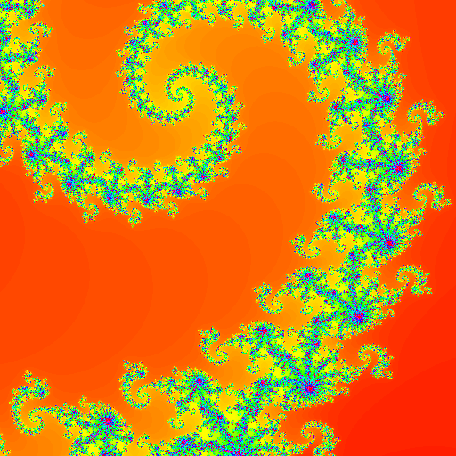
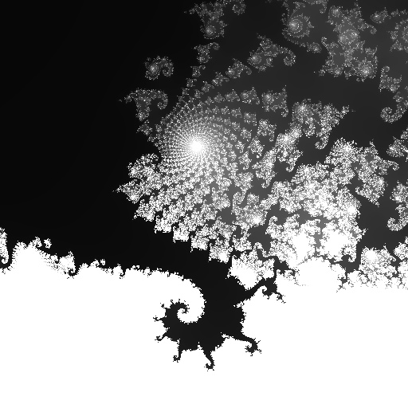
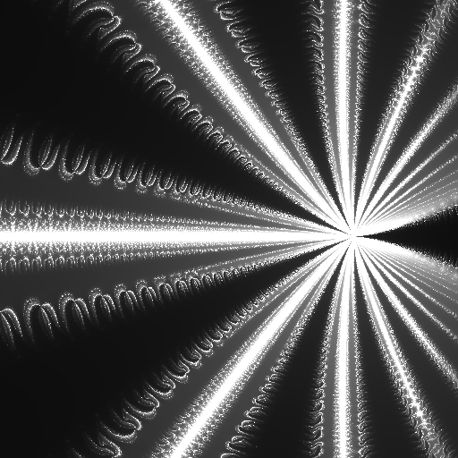
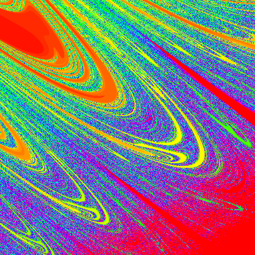
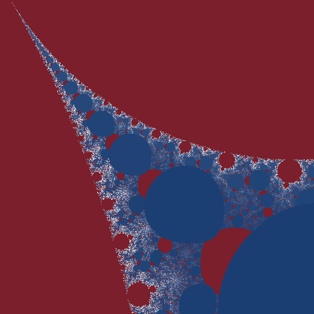

# etfra
**Escape Time FRActal**

`etfra` は、Rust で開発しているフラクタル画像生成・探索プロジェクトである．

Mandelbrot 集合や Julia 集合などの複素力学系に基づくフラクタルを計算し，色付けして画像として描画する。

GUI によるインタラクティブな探索に加え，フラクタルの計算・描画を行うライブラリとしても利用する．

## Gallery

生成したフラクタル画像の例:






## Features

### Fractal generation

以下の複素力学系を利用したフラクタルの生成に対応

- Mandelbrot
- Julia
- Burning Ship
- Perpendicular Burning Ship
- Tricorn (Mandelbar)
- Phoenix
- Multibrot
- Magnet
- 任意の漸化式

### Coloring

計算結果に対して，さまざまな色付けを適用する

- Color maps
- Coloring methods
- Normalization

色付けと正規化を組み合わせることで、異なる表現のフラクタル画像を作る．

### Interactive GUI

GUI でフラクタル画像を表示しながら探索する

- フラクタルの種類やパラメータの変更
- 表示位置の移動
- ズームイン・ズームアウト
- 表示中心座標の指定
- 解像度の変更
- 反復回数などの計算パラメータの変更
- 色付け設定の変更
- 設定のインポート・エクスポート
- 画像のエクスポート
- Undo による操作の取り消し

## Getting Started

### Requirements

- Rust
- Cargo

### Build

```bash
cargo build --release
```

### Run
GUI アプリの実行:
```bash
cargo run --release --bin gui
```

## GUI Controls
| Key | Action |
|---|---|
| `W` / `A` / `S` / `D` | 表示位置の移動 |
| Arrow Keys | 表示位置の移動 |
| `Shift` + Arrow | 移動量を半分にする |
| `Q` | Zoom in |
| `E` | Zoom out |
| `R` | 再描画 |
| `L` | 中心線の表示切り替え |
| `Z` | Undo |
| `X` | Survey |
| `C` | Burst |

## Settings
| Category | Description |
|---|---|
| Dynamics | フラクタルの種類や力学系のパラメータ |
| Coloring | 色付け方法やカラーマップ |
| Resolution | 画像の解像度やアスペクト比 |
| Iterations | 最大反復回数や脱出判定 |
| Render Mode | 描画モード |

設定はJSONでエクスポート・インポート可

## Project Structure

```text
etfra/
├── Cargo.toml
├── Cargo.lock
├── README.md
├── gallery/
│   ├── foo.png
│   ├── bar.png
│   └── baz.png
└── src/
    ├── bin/
    │   ├── gui/
    │   │   ├── main.rs
    │   │   └── app/
    │   ├── hiprec/
    │   └── mkimg/
    ├── presets/
    │   ├── complex_dynamics_presets.rs
    │   ├── coloring_presets.rs
    │   ├── color_map_presets.rs
    │   ├── escape_condition_presets.rs
    │   ├── escape_evaluator_presets.rs
    │   └── normalize_esc_info_presets.rs
    ├── util/
    ├── dynamics.rs
    ├── complex_dynamics.rs
    ├── escape_condition.rs
    ├── escape_evaluator.rs
    ├── escape_time_fractal.rs
    ├── coloring.rs
    ├── color_map.rs
    ├── normalize_esc_info.rs
    ├── presets.rs
    ├── prelude.rs
    └── lib.rs
```

### Main Components

| Module | Responsibility |
|---|---|
| `dynamics` | 力学系の基本的な定義 |
| `complex_dynamics` | 複素力学系 |
| `escape_condition` | 発散・脱出条件 |
| `escape_evaluator` | 反復計算と脱出結果の評価 |
| `escape_time_fractal` | フラクタルの計算と画像生成 |
| `coloring` | 計算結果の色付け |
| `color_map` | カラーマップ |
| `normalize_esc_info` | 計算結果の正規化 |
| `presets` | 組み込みの力学系や各種設定 |
| `util` | 画像設定や色・パレットなどのユーティリティ |

GUI 関連の実装は `src/bin/gui/` 以下に配置

## Dependencies
| Library | Purpose |
|---|---|
| [eframe](https://github.com/emilk/egui) | GUI |
| [num-complex](https://crates.io/crates/num-complex) | 複素数演算 |
| [num-traits](https://crates.io/crates/num-traits) | 数値演算の抽象化 |
| [rayon](https://crates.io/crates/rayon) | 並列計算 |
| [exmex](https://crates.io/crates/exmex) | 数式の解析・評価 |
| [image](https://crates.io/crates/image) | 画像生成・保存 |
| [serde](https://crates.io/crates/serde) | シリアライズ・デシリアライズ |
| [serde_json](https://crates.io/crates/serde_json) | JSON の入出力 |
| [chrono](https://crates.io/crates/chrono) | 日時処理 |

## Development
Test:
```bash
cargo test
```

Release build:
```bash
cargo build --release
```

## License
This project is licensed under the MIT License.
See the [LICENSE](LICENSE) file for details.